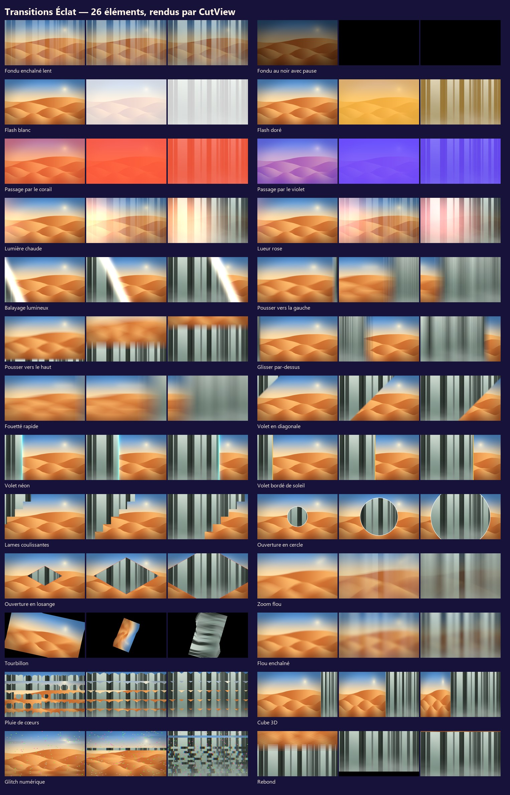
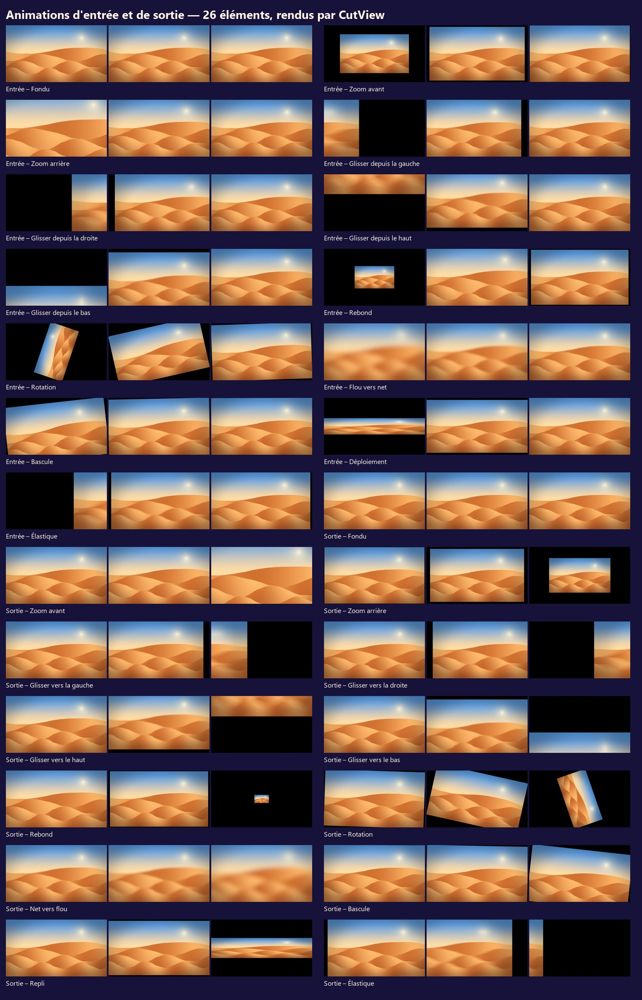
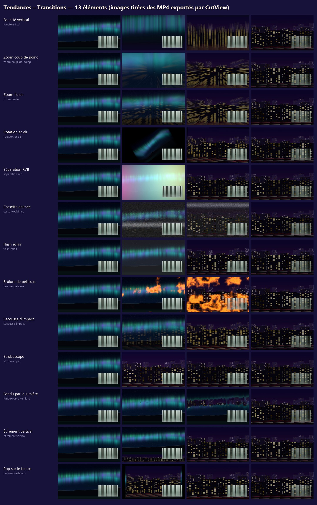
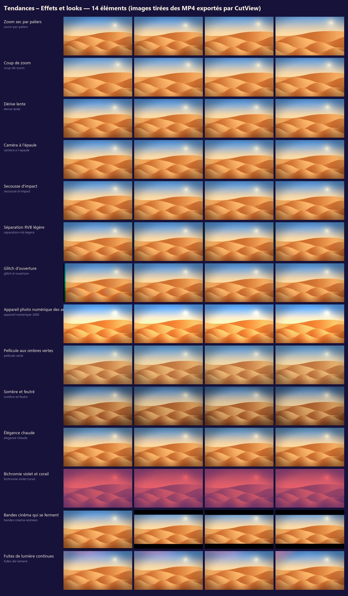

# Packs de contenu de CutView

Les packs que le panneau **Bibliothèque** de [CutView](https://github.com/Axel-sell/cutview-mises-a-jour/releases/latest)
propose au téléchargement : dans CutView, ouvrir la Bibliothèque (bouton en haut), choisir l'onglet, puis cliquer
sur « Télécharger » à côté du pack. Rien à faire sur cette page : CutView lit le catalogue (`catalog.json`), télécharge
le zip et vérifie sa taille et son empreinte SHA-256 avant de l'ouvrir. Un pack ne contient jamais de programme :
seulement des réglages, des modèles, des sons et des musiques.

## Licence

Tout ce que nous avons fait pour ces packs — préréglages de transitions, d'effets et d'animations,
modèles de titres, sons et musiques synthétisés, planches d'aperçu — est **versé au domaine public**
par Alex NGASSA : **CC0-1.0**, texte intégral dans [`LICENSE-CC0.txt`](LICENSE-CC0.txt). Aucun crédit
n'est exigé, usage commercial compris.

Les enregistrements téléchargés gardent la fiche de leur origine, elle aussi sans condition : CC0-1.0
ou domaine public. Le détail est donné élément par élément : champ `license` de chaque `pack.json`,
fiche `.attribution` à côté de chaque fichier, `ATTRIBUTION.md` des packs visuels et
[`LICENCES-AUDIO.md`](LICENCES-AUDIO.md) pour les sons et musiques.

## Packs visuels

Des réglages, jamais du code : chaque élément se sert des transitions, effets et titres que CutView
possède déjà. Créations originales d'Alex NGASSA, versées au domaine public (CC0-1.0, `LICENSE-CC0.txt`) : fiche `.attribution`
à côté de chaque fichier, et `ATTRIBUTION.md` dans chaque pack. Les packs « Tendances » reprennent ce qui se fait
en 2025-2026 sur les vidéos courtes.

| Pack | Onglet | Éléments | Taille du zip |
|---|---|---|---|
| **Transitions Éclat** (`transitions-eclat-1.0.0.zip`) | Transitions | 26 | 10 Ko |
| **Animations d'entrée et de sortie** (`animations-entree-sortie-1.0.0.zip`) | Animations | 26 | 21 Ko |
| **Tendances – Transitions** (`tendances-transitions-1.0.0.zip`) | Transitions | 13 | 6 Ko |
| **Tendances – Effets et looks** (`tendances-effets-looks-1.0.0.zip`) | Effets | 14 | 13 Ko |
| **Tendances – Rampes de vitesse** (`tendances-rampes-vitesse-1.0.0.zip`) | Effets | 5 | 4 Ko |
| **Tendances – Styles de sous-titres** (`tendances-styles-sous-titres-1.0.0.zip`) | Titres | 8 | 5 Ko |

### Transitions Éclat

26 transitions prêtes : fondus, flashs, lumières, volets, ouvertures, zooms et mouvements.

- **Fondu enchaîné lent** — Les deux plans se mêlent en douceur, sur 30 images.
- **Fondu au noir avec pause** — Descend au noir, marque un temps, puis remonte : pour changer de lieu ou de moment.
- **Flash blanc** — Un éclair blanc bref, comme un déclencheur d'appareil photo.
- **Flash doré** — Un éclair chaud et doré, pour les fêtes et les mariages.
- **Passage par le corail** — Un fondu qui traverse une couleur corail vive.
- **Passage par le violet** — Un fondu qui traverse un violet profond.
- **Lumière chaude** — Une fuite de lumière orangée qui embrase la coupe.
- **Lueur rose** — Une lueur rose et douce, pour les souvenirs et les moments tendres.
- **Balayage lumineux** — Un rai de lumière traverse l'image en diagonale.
- **Pousser vers la gauche** — Le plan suivant pousse le premier hors de l'image, avec un léger flou de bougé.
- **Pousser vers le haut** — Le plan suivant monte et pousse le premier vers le haut, comme un fil d'actualité.
- **Glisser par-dessus** — Le plan suivant glisse depuis la gauche et recouvre le premier.
- **Fouetté rapide** — Un mouvement de caméra très rapide et flou d'un plan à l'autre.
- **Volet en diagonale** — Un volet net qui balaie l'image en diagonale.
- **Volet néon** — Un volet souligné d'une lueur menthe, très moderne.
- **Volet bordé de soleil** — Un volet vertical bordé d'un liseré jaune soleil.
- **Lames coulissantes** — Six bandes qui découvrent le plan suivant l'une après l'autre.
- **Ouverture en cercle** — Le plan suivant s'ouvre depuis le centre en un cercle bordé de blanc.
- **Ouverture en losange** — Un losange bordé de corail qui grandit depuis le centre.
- **Zoom flou** — Un zoom rapide avec un flou radial qui traverse la coupe.
- **Tourbillon** — L'image tourne sur elle-même et révèle le plan suivant.
- **Flou enchaîné** — Le premier plan se floute, le suivant devient net.
- **Pluie de cœurs** — Des cœurs apparaissent un peu partout et s'ouvrent sur le plan suivant : pour les mariages et la Saint-Valentin.
- **Cube 3D** — Les deux plans sont deux faces d'un cube qui pivote.
- **Glitch numérique** — Une coupe hachée et décalée, façon écran qui saute.
- **Rebond** — Le plan suivant arrive par le bas et rebondit avant de se poser.

### Animations d'entrée et de sortie

13 entrées et 13 sorties : fondu, zooms, glissés, rebond, rotation, flou… L'entrée se cale toujours au début du plan, la sortie toujours à sa fin.

- **Entrée – Fondu** — Le plan apparaît en fondu, en 0,6 seconde.
- **Entrée – Zoom avant** — Le plan grandit vers vous en apparaissant.
- **Entrée – Zoom arrière** — Le plan arrive de très près et recule à sa place.
- **Entrée – Glisser depuis la gauche** — Le plan entre par la gauche et freine en douceur.
- **Entrée – Glisser depuis la droite** — Le plan entre par la droite et freine en douceur.
- **Entrée – Glisser depuis le haut** — Le plan entre par le haut et freine en douceur.
- **Entrée – Glisser depuis le bas** — Le plan entre par le bas et freine en douceur.
- **Entrée – Rebond** — Le plan surgit, dépasse un peu sa taille et rebondit.
- **Entrée – Rotation** — Le plan tourne d'un quart de tour en grandissant.
- **Entrée – Flou vers net** — Le plan sort du flou et devient net, en avançant à peine.
- **Entrée – Bascule** — Le plan monte en se redressant légèrement.
- **Entrée – Déploiement** — Le plan s'ouvre depuis une ligne horizontale, comme un vieux téléviseur.
- **Entrée – Élastique** — Le plan arrive par la droite, dépasse sa place et revient, comme tiré par un élastique.
- **Sortie – Fondu** — Le plan disparaît en fondu sur ses 0,6 dernières secondes.
- **Sortie – Zoom avant** — Le plan fonce vers vous et s'efface.
- **Sortie – Zoom arrière** — Le plan rapetisse et s'éloigne en s'effaçant.
- **Sortie – Glisser vers la gauche** — Le plan prend de la vitesse et sort par la gauche.
- **Sortie – Glisser vers la droite** — Le plan prend de la vitesse et sort par la droite.
- **Sortie – Glisser vers le haut** — Le plan prend de la vitesse et sort par le haut.
- **Sortie – Glisser vers le bas** — Le plan prend de la vitesse et sort par le bas.
- **Sortie – Rebond** — Le plan gonfle un instant puis se réduit à rien.
- **Sortie – Rotation** — Le plan tourne d'un quart de tour en rapetissant.
- **Sortie – Net vers flou** — Le plan se floute et s'efface en avançant à peine.
- **Sortie – Bascule** — Le plan tombe en basculant légèrement.
- **Sortie – Repli** — Le plan se replie en une ligne horizontale, comme un vieux téléviseur qu'on éteint.
- **Sortie – Élastique** — Le plan recule un peu, prend son élan et part vers la gauche.

### Tendances – Transitions

13 transitions des vidéos courtes de 2025-2026 : fouetté vertical, zoom coup de poing, rotation éclair, séparation RVB, cassette abîmée, flash éclair, brûlure de pellicule, secousse…

- **Fouetté vertical** — Le plan file vers le haut dans un flou de mouvement : le geste des vidéos verticales, sur 8 images.
- **Zoom coup de poing** — Un zoom violent qui traverse la coupe en 8 images : à caler sur un temps fort.
- **Zoom fluide** — La caméra plonge en douceur dans le plan suivant, avec un léger flou de mouvement.
- **Rotation éclair** — Un demi-tour express, flou de mouvement à fond, sur 8 images.
- **Séparation RVB** — Les couches rouge, verte et bleue se décalent le temps de la coupe : glitch court de 6 images.
- **Cassette abîmée** — La bande vidéo saute et se brouille entre les deux plans, comme une vieille VHS.
- **Flash éclair** — Un flash blanc de 4 images seulement, sec comme un déclencheur : la coupe sur le temps.
- **Brûlure de pellicule** — La pellicule brûle en orange et laisse place au plan suivant.
- **Secousse d'impact** — L'image tremble fort sur la coupe puis se calme : pour un choc, une chute, un temps fort.
- **Stroboscope** — Les deux plans clignotent en alternance, image par image, avant de se fixer.
- **Fondu par la lumière** — Le plan suivant apparaît d'abord dans les zones claires de l'image (fondu de luminance).
- **Étirement vertical** — Le plan suivant arrive par le bas en s'étirant : rapide et nerveux, taillé pour le 9:16.
- **Pop sur le temps** — Le plan suivant surgit en grossissant et dépasse un peu sa taille : à poser sur une note.

### Tendances – Effets et looks

14 effets et looks des vidéos courtes : zooms par paliers et coups de zoom, secousses, glitch RVB, appareil numérique des années 2000, pellicule, sombre et feutré, élégance chaude, bichromie, bandes cinéma…

- **Zoom sec par paliers** — Recadrage en trois temps sans animation : 100 %, puis 112 % à 0,5 s, puis 124 % à 1 s. À poser sur un plan qui parle, temps forts calés sur la voix ou la musique.
- **Coup de zoom** — Le plan bondit à 120 % en 2 images au début, puis se pose à 112 % : l'accent qui souligne une phrase.
- **Dérive lente** — Un zoom imperceptible de 100 à 110 % sur toute la durée du plan : une photo ou un plan fixe prend vie.
- **Caméra à l'épaule** — Un léger flottement continu, comme filmé à la main : rend vivant un plan trop sage.
- **Secousse d'impact** — Le plan tremble fort au début puis se calme en 0,45 s : un choc, une chute, une révélation.
- **Séparation RVB légère** — Les couleurs se décalent de quelques pixels sur tout le plan : une touche numérique, Y2K.
- **Glitch d'ouverture** — Le plan démarre en sautant : couleurs décalées et image qui bouge sur les dix premières images, puis tout se fixe.
- **Appareil photo numérique des années 2000** — Un peu surexposé, net mais pas trop, grain de capteur coloré : le look « digicam » qui revient. Va bien avec le titre « Date d'appareil photo ».
- **Pellicule aux ombres vertes** — Ombres légèrement vertes, rouges plus froids, noirs voilés et grain fin : une émulation de film couleur d'inspiration japonaise.
- **Sombre et feutré** — Ombres profondes et bleutées, hautes lumières ambrées, couleurs retenues : le look « dark moody ».
- **Élégance chaude** — Lumière chaude, hautes lumières crème, verts tirés vers l'olive et grain très fin : le look « old money ».
- **Bichromie violet et corail** — L'image en deux couleurs : ombres violet profond, lumières corail. Pour une affiche, un collage, une intro.
- **Bandes cinéma qui se ferment** — Deux bandes noires descendent et montent en 0,5 s au début du plan pour le cadre large 2,39:1.
- **Fuites de lumière continues** — Des lueurs orange et magenta passent lentement sur l'image pendant tout le plan, comme une pellicule voilée.

### Tendances – Styles de sous-titres

Huit styles pour les sous-titres automatiques (format de pack 2 : CutView lot 8b et suivants). Un double-clic dans la
Bibliothèque (onglet Titres) donne le style à toute la piste de sous-titres ; le mot prononcé suit les horodatages
de la transcription.

- **Gras vert** — Capitales blanches cernées de noir, trois mots par ligne ; le mot prononcé passe au vert et grossit.
- **Gélule rouge** — Une gélule rouge aux bouts ronds glisse sous le mot prononcé ; texte blanc avec une ombre douce.
- **Jaune beurre calme** — Le minimalisme calme : texte jaune beurre sans contour, ombre légère, chaque mot apparaît en fondu.
- **Accroche en haut** — En haut de l'image, capitales blanches cernées de noir ; le mot prononcé passe à l'orange.
- **Machine à écrire** — Lettres à chasse fixe sur une bande noire aux coins arrondis ; les mots arrivent un à un, en fondu.
- **Sérif élégant** — Un sérif sobre en blanc, ombre douce ; le mot prononcé se teinte d'or.
- **Bleu électrique** — Capitales blanches cernées de bleu nuit qui surgissent mot après mot ; le mot prononcé passe au bleu vif.
- **Karaoké rose** — Les mots s'allument en rose quand ils sont prononcés et restent allumés, comme au karaoké.

## Packs audio

Bruitages en WAV (le bouton d'écoute de la Bibliothèque les joue), ambiances en WAV stéréo, musiques en MP3
192 kbit/s vers -16 LUFS. Origines admises : CC0, domaine public, ou œuvre originale d'Alex NGASSA synthétisée
par ordinateur (CC0). Jamais de Pixabay, Mixkit, bibliothèque YouTube, ni de licence
à crédit (BY), non commerciale (NC) ou sans modification (ND), ni de musique protégée. Liste complète, fichier par
fichier : [`LICENCES-AUDIO.md`](LICENCES-AUDIO.md).

| Pack | Éléments | Taille du zip | Licences |
|---|---|---|---|
| **Musiques – Mariage, anniversaire et cérémonie** (`musiques-ceremonies-1.0.0.zip`) | 10 | 29,5 Mo | CC0-1.0 / Public domain (selon l'élément) |
| **Musiques – Émotion, suspense et comédie** (`musiques-emotion-suspense-1.0.0.zip`) | 12 | 31,4 Mo | CC0-1.0 / Public domain (selon l'élément) |
| **Musiques – Sport, fête et percussions** (`musiques-energie-fete-1.0.0.zip`) | 13 | 36,9 Mo | CC0-1.0 / Public domain (selon l'élément) |
| **Musiques – Entreprise, voyage et voix off** (`musiques-entreprise-voyage-1.0.0.zip`) | 12 | 29,3 Mo | CC0-1.0 / Public domain (selon l'élément) |
| **Sons – Ambiances de nature et de pluie** (`sons-ambiances-nature-1.0.0.zip`) | 7 | 30,5 Mo | CC0-1.0 / Public domain (selon l'élément) |
| **Sons – Ambiances de ville et d'intérieur** (`sons-ambiances-ville-1.0.0.zip`) | 9 | 41,9 Mo | CC0-1.0 / Public domain (selon l'élément) |
| **Sons – Fêtes et événements** (`sons-fetes-evenements-1.0.0.zip`) | 23 | 43,9 Mo | CC0-1.0 / Public domain (selon l'élément) |
| **Sons – Humain, comédie et suspense** (`sons-humain-comedie-suspense-1.0.0.zip`) | 29 | 30,2 Mo | CC0-1.0 / Public domain (selon l'élément) |
| **Sons – Transitions et interface** (`sons-transitions-interface-1.0.0.zip`) | 38 | 7,5 Mo | CC0-1.0 |
| **Tendances – Sons** (`tendances-sons-1.0.0.zip`) | 20 | 12,5 Mo | CC0-1.0 |

Conçu par Alex NGASSA.
